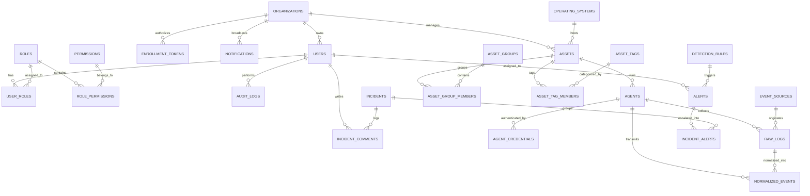
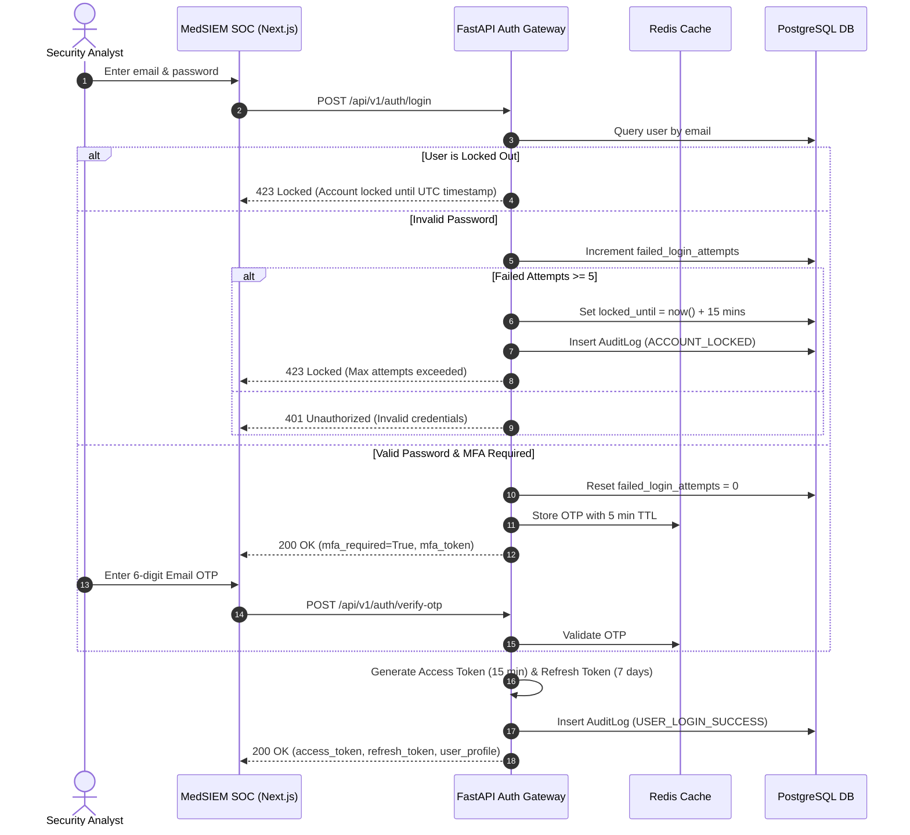

# MEDSIEM — SYSTEM ARCHITECTURE SPECIFICATION
## Phase 1: Core Platform, Architecture & Application Foundation

**Version:** 1.0.0 (Phase 1 Baseline)  
**Author:** Principal Software Architect & Senior Full-Stack Engineer  
**Classification:** Enterprise Healthcare Cybersecurity Infrastructure  
**System Category:** Independent Healthcare Security Information & Event Management (SIEM)  
**Status:** IMPLEMENTED & VERIFIED  

---

## 1. System Identity & Mission

MedSIEM is a purpose-built Security Information and Event Management (SIEM) and Security Operations Center (SOC) platform engineered specifically for healthcare delivery organizations (HDOs), clinical hospital networks, medical device environments (IoMT), and health information exchanges (HIEs).

Unlike generic enterprise SIEM solutions, MedSIEM embeds **Clinical Context Awareness**, **Healthcare Asset Criticality**, **Explainable Detection Rationales**, and **Endpoint Trust Verification** directly into its core data pipeline and detection logic. This guarantees that security operations prioritize incidents based on patient safety, operational continuity of life-critical care units, and regulatory compliance (HIPAA Security Rule, HITECH, FDA Cybersecurity for Medical Devices).

---

## 2. System Topology & Architectural Overview

MedSIEM follows a **distributed-agent, centralized-SOC** topology designed for resilience, strict HIPAA compliance, and minimal clinical network footprint.

```
+----------------------------------------------------------------------------------------------------+
|                                    DISTRIBUTED CLINICAL ENDPOINTS                                  |
|                                                                                                    |
|  +--------------------------------+  +-------------------------------+  +-----------------------+  |
|  |  PACS / Diagnostic Station     |  |  EHR / EMR Clinical Server    |  |  ICU Telemetry Gateway|  |
|  |  MedSIEM Endpoint Agent (Py)   |  |  MedSIEM Endpoint Agent (Py)  |  |  Syslog / Sysmon Fwd  |  |
|  +---------------+----------------+  +---------------+---------------+  +-----------+-----------+  |
|                  | (TLS 1.3 / HMAC)                  | (TLS 1.3 / HMAC)             | (Syslog)     |
+------------------|-----------------------------------|------------------------------|--------------+
                   |                                   |                              |
                   v                                   v                              v
+----------------------------------------------------------------------------------------------------+
|                                MEDSIEM CENTRALIZED SIEM PLATFORM                                   |
|                                                                                                    |
|  +-----------------------------------------------------------------------------------------------+ |
|  |                         FastAPI Core Application & API Gateway (:8000)                        | |
|  |                                                                                               | |
|  |  +------------------------------------------------------------------------------------------+ | |
|  |  |                     Security & Tracing Middleware (SecurityHeaders, UUID Tracing)         | | |
|  |  +------------------------------------------------------------------------------------------+ | |
|  |  +---------------------------+  +-----------------------------+  +--------------------------+ | |
|  |  |   Auth & RBAC Subsystem   |  |   Asset & Agent Registry    |  | Ingestion & Normalizer   | | |
|  |  |   - Dual JWT (Access/Ref) |  |   - Enrollment Token Vault  |  | - Single & Batch Ingest  | | |
|  |  |   - 5-Strike Lockout Ctrl |  |   - Heartbeat & Telemetry   |  | - Schema Validator       | | |
|  |  |   - Email OTP MFA         |  |   - Trust & Collector Health|  | - Sysmon/Syslog Parsers  | | |
|  |  +---------------------------+  +-----------------------------+  +--------------------------+ | |
|  |  +------------------------------------------------------------------------------------------+ | |
|  |  |                 Detection & Incident Engine (MITRE ATT&CK Mapping)                       | | |
|  |  |                 - Multi-Condition Rule Evaluator  - Explainable Detection Rationale       | | |
|  |  |                 - Alert Dispatcher                - Incident Escalation Manager          | | |
|  |  +------------------------------------------------------------------------------------------+ | |
|  +-----------------------------------------------------------------------------------------------+ |
|                                   |                    |                     |                     |
|                                   v                    v                     v                     v
|  +--------------------------------+  +-----------------+  +------------------+  +----------------+ |
|  | PostgreSQL 16 Relational Store |  | OpenSearch 2.13 |  | Redis 7 Memory   |  | MinIO S3 Object| |
|  | - 26 Normalized Tables         |  | - Full-Text Log |  | - Rate Limiting  |  | - Preserved Raw| |
|  | - Assets, Rules, Alerts, Audit |  |   Event Index   |  | - Active Sessions|  |   Log Archives | |
|  | - Enrollment Tokens & Creds    |  | - Fast Query    |  | - Lockout Counters| - Attachments  | |
|  +--------------------------------+  +-----------------+  +------------------+  +----------------+ |
+----------------------------------------------------------------------------------------------------+
                                            ^                                       ^
                                            | (REST / HTTPS)                        | (REST / Push)
+-------------------------------------------|--------------------+ +----------------|----------------+
|           WEB SECURITY OPERATIONS CENTER (:3000)               | |   ANDROID COMPANION APPLICATION |
|  Next.js 15 App Router | React 19 | TypeScript | Tailwind CSS  | |   Kotlin / Jetpack Compose      |
|  - Persistent 12-Item Navigation Rail                          | |   - Biometric Triage Auth       |
|  - Real-time Velocity Charts, Threat Map, Inspection Panels    | |   - High-Priority Push Alerts   |
+----------------------------------------------------------------+ +---------------------------------+
```

---

## 3. Technology Stack Specification

| Tier | Component | Technology | Version | Purpose & Rationale |
| :--- | :--- | :--- | :--- | :--- |
| **Backend Framework** | Application Core | **FastAPI** | `0.110.0+` | High-throughput async ASGI framework with native OpenAPI/Swagger auto-generation. |
| **Backend Runtime** | Python Interpreter | **Python** | `3.11.9` | Optimized performance, enhanced exception groups, strong typing support. |
| **Data Validation** | Schema Definition | **Pydantic** | `v2.6+` | Strict schema validation, fast serialization, and standard API contract enforcement. |
| **ORM & Database Engine**| Object Relational Mapper| **SQLAlchemy** | `2.0+` | Clean declarative data models, connection pooling, and multi-tenant scoping. |
| **Schema Migration** | Database Migrations | **Alembic** | `1.13+` | Version-controlled, reversible schema migrations guaranteeing data preservation. |
| **Primary Relational Store**| Primary Database | **PostgreSQL** | `16.2` | ACID compliance, JSONB queries, relational integrity for assets, users, and alerts. |
| **Full-Text Log Index** | Log Search Engine | **OpenSearch** | `2.13.0` | Distributed full-text log search, indexing at high ingestion rates. |
| **Cache & State Store** | Cache / Session | **Redis** | `7.2` | Microsecond-latency cache for rate limiting, login strike counters, and sessions. |
| **Object Storage** | Blob Store | **MinIO S3** | `RELEASE.2024+` | S3-compatible immutable storage for raw forensic log retention and forensic dumps. |
| **Web Frontend** | SOC UI Framework | **Next.js** | `15.0+` | App Router, Server Components, production-grade enterprise frontend. |
| **UI Library** | Component Architecture | **React** | `19.0+` | Modular declarative components, hooks, and reactive telemetry streams. |
| **Styling & Theme** | Cyber Design System | **Tailwind CSS**| `3.4+` | Dark navy palette (`#070b14`), custom charcoal cards (`#0f172a`), cyber neon accents. |
| **Data Visualization** | SOC Metric Charts | **Recharts** | `2.12+` | Responsive SVG time-series velocity graphs, severity distribution, radar charts. |
| **Icons & Indicators** | Iconography | **Lucide Icons** | `0.359+` | Lightweight, consistent cybersecurity and clinical iconography. |
| **Mobile Client** | Companion App | **Android** | `API 34+` | Native Kotlin / Jetpack Compose for on-call triage and emergency response. |
| **Container Engine** | Orchestration | **Docker Compose**| `v2.24+` | Unified multi-container orchestration with resource limits and health checks. |

---

## 4. Database Foundation & Relational Architecture

The MedSIEM relational database foundation in PostgreSQL 16 contains **26 normalized tables** structured into distinct functional domains. All entities utilize **UUIDv4** as primary keys and enforce **UTC ISO-8601 timestamps**.

### 4.1 Schema Domain Mapping

```
+----------------------------------------------------------------------------------------------------+
|                                    MEDSIEM DATABASE DOMAINS                                        |
+----------------------------------------------------------------------------------------------------+
| 1. Multi-Tenancy & Org      | organizations                                                        |
+-----------------------------+----------------------------------------------------------------------+
| 2. Identity, Auth & RBAC    | users, roles, permissions, role_permissions, user_roles, audit_logs  |
+-----------------------------+----------------------------------------------------------------------+
| 3. Asset & Endpoint Registry| assets, asset_groups, asset_group_members, asset_tags,               |
|                             | asset_tag_members, operating_systems, agents, agent_credentials,      |
|                             | enrollment_tokens                                                    |
+-----------------------------+----------------------------------------------------------------------+
| 4. Telemetry & Ingestion    | raw_logs, normalized_events, event_sources                           |
+-----------------------------+----------------------------------------------------------------------+
| 5. Detection & Incidents    | detection_rules, alerts, incidents, incident_alerts, incident_comments|
+-----------------------------+----------------------------------------------------------------------+
| 6. Operator Communication   | notifications                                                        |
+----------------------------------------------------------------------------------------------------+
```

### 4.2 Entity-Relationship Architecture



### 4.3 Database Migration Strategy & Data Integrity Guarantee

1. **Reversible Migration Chain**:
   ```
   [0001_initial_baseline] -> [ed9d8f956b2b] -> [0002_phase1_foundation] (HEAD)
   ```
2. **Zero-Destruction Contract**: Every migration is authored with idempotent guards (`IF NOT EXISTS`, safe column additions with defaults). No existing production table is dropped, truncated, or restructured in a way that risks clinical audit records.
3. **Rollback Verification**: The down-revision paths in `0002_add_phase1_foundation_models.py` cleanly remove newly introduced columns and tables in reverse dependency order without cascading into baseline records.

---

## 5. Authentication, RBAC & HIPAA Security Safeguards

### 5.1 Dual-Token Authentication Flow



### 5.2 Role-Based Access Control (RBAC) Matrix

| Permission | Super Admin | SOC Analyst | Viewer | Scope |
| :--- | :---: | :---: | :---: | :--- |
| `alerts.read` |  |  |  | Read security alerts, telemetry, and rule statistics |
| `alerts.update` |  |  | ❌ | Assign alerts, update alert status, resolve alerts |
| `incidents.manage`|  |  | ❌ | Escalate incidents, post analyst notes, resolve incidents |
| `users.read` |  |  |  | View user accounts, endpoint agents, and asset inventory |
| `users.create` |  | ❌ | ❌ | Create user accounts and issue agent enrollment tokens |
| `users.update` |  | ❌ | ❌ | Modify user roles and revoke endpoint agent credentials |
| `users.delete` |  | ❌ | ❌ | Delete users or asset inventory items |
| `settings.manage` |  | ❌ | ❌ | Author detection rules, manage asset groups, audit settings |

### 5.3 HIPAA Security Rule Technical Safeguards
- **§ 164.312(a)(1) Access Control**: Unique user identification, mandatory role separation, automatic session timeout after token expiration.
- **§ 164.312(a)(2)(iii) Automatic Logoff**: Web client terminates active sessions on inactivity; JWT access tokens expire strictly after 15 minutes.
- **§ 164.312(b) Audit Controls**: Every authentication attempt, password change, agent registration, alert modification, and incident triage action creates an immutable record in `audit_logs`.
- **§ 164.312(e)(1) Transmission Security**: Enforced TLS 1.3 for all endpoint agent telemetry and HTTPS for SOC operator interfaces.

---

## 6. Unique Product Foundations

MedSIEM's architecture is differentiated by four purpose-built clinical cybersecurity engines:

```
+----------------------------------------------------------------------------------------------------+
|                                 MEDSIEM UNIQUE HEALTHCARE ENGINES                                  |
+----------------------------------------------------------------------------------------------------+
| A. Healthcare Asset Criticality    | B. Endpoint Trust & Collector Health                          |
| - Critical (Pacemakers, ICU, PACS) | - Cryptographic Enrollment Tokens                             |
| - High (EHR/EMR, Lab LIS)          | - Telemetry Freshness Metric (seconds)                        |
| - Medium (Pharmacy, Workstations)  | - Collector Health Matrix (CPU, Memory, Ingest Queue, Status) |
| - Low (General Office IT)          | - Automated Revocation & Quarantining                         |
+------------------------------------+---------------------------------------------------------------+
| C. Explainable Detection Engine    | D. Clinical Service Context                                   |
| - Deterministic Condition Match    | - Hospital Department (Cardiology, Radiology, Oncology, ICU)  |
| - Supporting Telemetry Evidence    | - Associated Clinical Service (Patient Monitoring, Diagnostic)|
| - Detection Timestamp Normalization| - Operational Dependency (HL7/DICOM/EHR Bridges)              |
| - Clinical Risk Rationale Text     | - Potential Patient Safety & Operational Impact Rating        |
+----------------------------------------------------------------------------------------------------+
```

### 6.1 Healthcare Asset Criticality
Asset criticality is modeled as a first-class enumerated column on `assets` (`AssetCriticality`):
- **`CRITICAL`**: Life-support medical devices, ICU patient monitors, surgical robotics, Picture Archiving and Communication Systems (PACS), emergency room networks. Downtime or compromise poses immediate patient safety risks.
- **`HIGH`**: Electronic Health Record (EHR) core databases, Laboratory Information Systems (LIS), computerized provider order entry (CPOE) systems, hospital pharmacy dispensing cabinets.
- **`MEDIUM`**: Hospital administration workstations, non-critical telemetry gateways, digital signage, visitor management portals.
- **`LOW`**: Development/testing environments, guest Wi-Fi infrastructure, public information kiosks.

### 6.2 Endpoint Trust & Collector Health
Agent telemetry trust is continuously scored based on:
1. **Pre-Shared Enrollment Tokens**: Tokens (`enrollment_tokens`) issued by authorized administrators enforce expiration dates, maximum allowed uses, and tenant binding.
2. **Telemetry Freshness (`telemetry_freshness_seconds`)**: Measures elapsed seconds since the agent's last accepted normalized log batch. Endpoints exceeding 300 seconds are flagged as *Stale*; exceeding 900 seconds triggers an *Agent Disconnected* alert.
3. **Collector Health Metrics (`collector_health`)**: Structured JSON containing:
   ```json
   {
     "status": "healthy",
     "cpu_percent": 1.4,
     "memory_mb": 42.8,
     "disk_free_gb": 128.4,
     "collector_uptime_seconds": 86400,
     "events_queued": 0,
     "events_dropped": 0,
     "syslog_listener_active": true
   }
   ```

### 6.3 Explainable Detection Engine
Alerts generated by the detection engine contain structured explainability attributes rather than opaque rule names:
- **`matched_conditions`**: The exact boolean logic and attribute comparisons that satisfied the detection trigger.
- **`supporting_events`**: Array of event IDs and timestamps representing the raw and normalized telemetry that contributed to the alert.
- **`detection_timestamp`**: Normalized UTC timestamp of detection occurrence.
- **`severity_rationale`**: Human-readable clinical risk impact narrative detailing why the alert warrants its assigned severity.

### 6.4 Clinical Service Context
Assets maintain deep clinical operational dependencies:
- **`department`**: Clinical unit (e.g., `Radiology & Imaging`, `Intensive Care Unit (ICU)`, `Cardiology`, `Pathology`).
- **`clinical_service`**: The clinical function performed (e.g., `DICOM Image Archival & Triage`, `Bedside Hemodynamic Monitoring`, `Ambulatory Chemotherapy Infusion`).
- **`operational_dependency`**: Critical upstream and downstream infrastructure (e.g., `EMR Bridge & PACS Server Gateway`, `Central Nursing Telemetry Station`).
- **`potential_operational_impact`**: Assessment of clinical fallout upon compromise (e.g., `Immediate diagnostic imaging halt; surgery scheduling suspension`).

---

## 7. Data Ingestion & Detection Pipeline

```
[Raw Syslog / Agent Stream]
           |
           v
[POST /api/v1/events/ingest]
           |
           +---> 1. Persist Raw Log Archive (raw_logs / MinIO)
           |
           v
[Canonical Normalization Engine]
- Map timestamp to UTC
- Parse Event ID / Sysmon / Syslog RFC 5424
- Extract Source IP, Destination IP, User, Process, Hostname
- Assign Severity Score
           |
           +---> 2. Store Normalized Event (normalized_events in PostgreSQL)
           |
           +---> 3. Index Event in OpenSearch (medsiem-events index)
           |
           v
[Detection Rule Evaluator]
- Evaluate against active rules (detection_rules)
- Match event properties (process name, failed logins, port scans)
- Compute MITRE ATT&CK technique (e.g., T1078, T1059)
           |
           +---[Condition Matched?]---> YES
                                          |
                                          v
                              [Generate Alert (alerts)]
                              - Populate Explainable Rationale
                              - Attach Supporting Event References
                              - Compute Clinical Asset Impact
                                          |
                                          +---[Critical Severity?]---> Auto-create Incident (incidents)
                                          |
                                          v
                              [Broadcast Notification (notifications)]
```

---

## 8. Web Application Architecture (Next.js 15 SOC)

### 8.1 Visual Design Tokens
- **Canvas / Root Background**: `#070b14` (Deep Space Navy)
- **Primary Surface / Cards**: `#0f172a` (Slate Charcoal)
- **Surface Elevation**: `#1e293b` (Elevated Slate)
- **Borders & Dividers**: `rgba(255, 255, 255, 0.08)` / `#334155`
- **Primary Accent**: `#06b6d4` (Cyber Cyan) & `#3b82f6` (Electric Blue)
- **Critical Severity**: `#ef4444` (Vibrant Coral Red)
- **High Severity**: `#f97316` (Neon Orange)
- **Medium Severity**: `#f59e0b` (Cyber Amber)
- **Low Severity**: `#10b981` (Emerald Green)

### 8.2 Primary Navigation Structure (12 Persistent Items)
1. **Overview** (`/`): Executive SOC command deck, threat posture, live velocity charts, critical alerts feed.
2. **Endpoints** (`/endpoints`): Agent fleet health, connectivity status, telemetry freshness, trust metrics.
3. **Live Events** (`/live-events`): Real-time streaming normalized telemetry log viewer.
4. **Alerts** (`/alerts`): Triaged security alerts with explainable clinical rationales and assignment controls.
5. **Incidents** (`/incidents`): Formal security incidents with timeline investigation notes.
6. **Assets** (`/assets`): Healthcare asset inventory with clinical service context and operational impact ratings.
7. **Detection Rules** (`/rules`): Active detection rules with MITRE ATT&CK taxonomy mapping.
8. **Log Explorer** (`/log-explorer`): Full-text OpenSearch query console with query syntax highlighting.
9. **Healthcare Intelligence** (`/healthcare-intelligence`): Departmental threat breakdown and clinical vulnerability matrix.
10. **Reports** (`/reports`): HIPAA compliance auditing and security posture reporting exports.
11. **Administration** (`/administration`): User management, RBAC role definitions, and immutable audit logs.
12. **Settings** (`/settings`): System configurations, SIEM retention policies, and enrollment tokens.

---

## 9. Container Orchestration & Deployment

The system is deployed via Docker Compose with dedicated health checks, network isolation, and volume persistence:

```yaml
services:
  medsiem-backend:
    build: ./backend
    ports: ["8000:8000"]
    depends_on:
      postgres: { condition: service_healthy }
      redis:    { condition: service_healthy }
      opensearch: { condition: service_healthy }

  medsiem-postgres:
    image: postgres:16-alpine
    ports: ["5432:5432"]
    volumes: [postgres_data:/var/lib/postgresql/data]

  medsiem-redis:
    image: redis:7-alpine
    ports: ["6379:6379"]
    volumes: [redis_data:/data]

  medsiem-opensearch:
    image: opensearchproject/opensearch:2.13.0
    ports: ["9200:9200"]
    volumes: [opensearch_data:/usr/share/opensearch/data]

  medsiem-minio:
    image: minio/minio:RELEASE.2024-05-10T01-41-38Z
    ports: ["9000:9000", "9001:9001"]
    volumes: [minio_data:/data]

  medsiem-frontend:
    build: ./frontend
    ports: ["3000:3000"]
    environment:
      - NEXT_PUBLIC_API_URL=http://localhost:8000/api/v1
```

---

## 10. Phase 1 Verification Status

- **Database Migrations**: `0002_phase1_foundation (head)` applied.
- **Automated Tests**: 16/16 tests passing in `medsiem-backend` (100% pass rate).
- **Web Build**: `next build` compiled 20/20 routes with 0 errors.
- **Services Online**: All 6 Docker services and Next.js frontend running concurrently.
